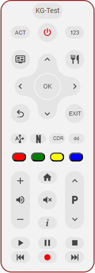
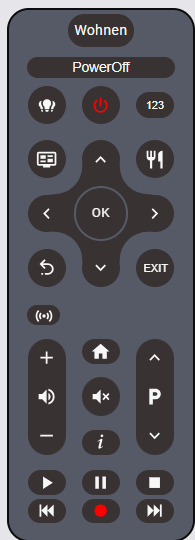
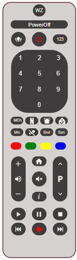
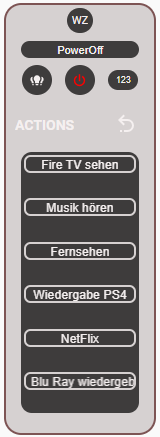

# My-Harmony-Card

A full Harmony Companion remote for Home Assistant – customizable buttons, favorites and any Home Assistant action.

[](https://github.com/hacs/integration)  
[](https://buymeacoffee.com/dezi)

This project is inspired by the LG WebOS Remote Card based on (madmicio's [repository](https://github.com/madmicio/LG-WebOS-Remote-Control))

<div style="display: flex; flex-wrap: wrap; align-items: center;">
  
  
  
  
  
</div>

# In short words
The [Harmony Card My-Harmony-Card](https://github.com/dezihh/my-harmony-card/) is a highly customizable remote control for managing a Harmony Remote Hub, offering flexible button assignments and configurable color design. It allows the remote's height to be adjusted based on the selected activity and provides the option to save favorites and other specific functions. Configured activities can be automatically imported and linked to specific device IDs for a easy setup process. Special buttons can be assigned individual commands or service calls for each activity. Additionally, it includes a scaling of the size of the remote for best fitting.

## Introduction

I couldn't find any remote controls for the Harmony that met my needs, either visually or functionally. Fortunately, I came across [Madmicio's](https://github.com/madmicio/LG-WebOS-Remote-Control) project, and I really liked the layout. Inspired by this, I decided to develop a solution for Harmony based on his work.

However, I encountered some limitations with the current implementation of the aioharmony library used by Home Assistant Core. Specifically, it doesn't handle actions as effectively as I'd hoped (or perhaps I missed something—any tips are welcome). While the library allows for switching device groups on and off and detecting which action is currently active, that's about the extent of its capabilities regarding actions.

As a result, it's not possible to directly map the Harmony's remote buttons to the physical remote's functions. To work around this, I decided to use actions to manage the device groups. Once an action is active, I directly control the device using its ID and configure the remote buttons as flexibly as possible.

## Card install

You can find this card by searching for "My-Harmony-Card" in the HACS Community Store. If that doesn't work or if you prefer a manual installation, you can find a detailed guide [here](Install.md).

## Card config:

At least the following entries must be present for the card to work:

```
- type: 'custom:my-harmony-card'
  entity: remote.<device>
```

### Main Options
You can find a screenshot of the remote with some button naming [here](https://github.com/dezihh/my-harmony-card/blob/master/pictures/Harmony_desc.png)

| Name | Type | Default | Example | Description |
| --- | --- | --- | --- | --- |
| `type` | string | **Required** | `custom:my-harmony-card` | Type of the card |
| `entity` | string | **Required** | remote.myharmonydevice | harmony entity |
| `name` | string | **Option** | Living | name of harmony device in HA, ie. living room |
| `activities` | Object | **Option** | see [activities](#activities-options) | Per-activity settings (device ids, favorites). Without it the card still works, but has no favorites and no activity-specific device mapping. |
| `device` | string | **Option** | `LG-Fernseher` | Adds a *direct device* entry to the activity list: all buttons go to this device while it is selected. Accepts a device name from `devices_list` or a numeric id. See [Device mode](#device-mode). |
| `device_name` | string | **Option** | Wohnzimmer-TV | Label for the direct entry. Defaults to the device name/id. |
| `tooltip` | bool | **Option** | false | Displays tooltip on hoover on buttons Guide, Menu, Home, Info, Keypad, and 'ACT' (Actions). |
| `Special` | object | **Option** | see [Button\[A-D\]](#buttona-d) | Free global select: 5th configurable global Button -  works on all activities same  |
| `Button[A-D]` | object | **Option** | see [Button\[A-D\]](#buttona-d) | 4 Buttons for global use. You can add to each button one service call. If all 4 buttons not configured, the buttons disappear and the remote will get smaller - works on all activities same  |
| `favsize` | int | **Option** | 80 | Size of the icons in the favorites popup |
| `faviconpath` | path | **Option** | /local/icons/ | Path were your station logos reside. Default it is a directory below this card (/local/community/my-harmony-card/stations/), but you can change it to a different directory i.e. /local/icons. This directory is not the physical directory, it is the directory, you can reach through Home Assistant. In my example the physical directory of /local/icons would be ~/www/icons.  |
| `dimensions` | object | **Option** | see [Dimensions](#dimensions) | Scale total size of remote and size of border |
| `colors` | object | **Option** | see [Colors](#colors) | Color setup of the remote (background, buttons,...) |
| `debug` | bool | **Option** | true | Provide debugging information in the browser's console.log if set to true |

### Import activities

You can import your configured activities by checking the import box in the configuration menu. This will automatically import your activities and assign 0 as the device_id for each new device. You can edit the device\_id directly if needed.

If your Harmony configuration changes (e.g., adding a new activity, renaming, etc.), you can re-import the activities by clicking 'Import Activities.' This will remove any unused activities and add new ones. Unchanged activities won't be affected, so you won't lose any data if you click the button again. :-)

## A very basic example:

```yaml
type: 'custom:my-harmony-card'
entity: remote.harmony_wohnzimmer
activities:
  Listen to Music:
    device_id: 59107742
  Watch TV:
    device_id: 59107742
```

The device_id is one of the most important parameters. It specifies which device is targeted when a command is sent. The number of the device that the remote control primarily interacts with should be entered as the device\_id. 

## How to find the device\_id?

The easiest way is the card editor: the device fields are suggestions filled
from the hub's `devices_list`, so you can pick a device by name. Home Assistant
resolves those names to the device id before sending the command; numeric ids
keep working exactly as before.

The device\_id of each device can also be found in the harmony_???.conf at the
end of the respective device definition and begins with _"id":_ . Please only
use the respective number. This file itself resides in the root directory of you Home Assistant installation (same directory as for configuration.yaml)
Example: device\_id: 77085993

```
   ~~~more functions~~~
     "Delete",
     "Apps",
     "Home"
   ],
   "id": "77085993"
 },
 ~~~next device~~~
```

## Device mode

The overlay lists the Harmony activities and, if `device` is set, one extra
entry for direct control of a single device. Activities remain hub macros;
the direct entry only changes where the buttons are sent.

```yaml
type: custom:my-harmony-card
entity: remote.harmony_wohnung
device: LG TV
device_name: TV direkt
```

```yaml
type: custom:my-harmony-card
entity: remote.harmony_wohnung
device: 77085993
```

### Choosing the device

`device` takes the label the Harmony hub reports for the device (the
`devices_list` attribute of the entity, offered as suggestions in the card
editor) or the numeric device id. Home Assistant matches labels
case-insensitively; ids always work. A label that matches no hub device makes
the `remote.send_command` call fail, so check the log if a key does nothing.
`device_name` is only the label of the entry in the list.

Behavior:

- Selecting the direct entry sends all buttons (d-pad, digits, volume,
  playback, colors) to `device`, without talking to the hub.
- The hub activity keeps running in the background. Selecting a Harmony
  activity in the list, or an activity change made elsewhere (hub, app,
  another client), returns the card to activity mode.
- `activities`, remaps and favorites follow the current activity, because the
  activity keeps running. Remapped keys keep their command; their
  `*_device_id` only applies in activity mode.
- `useChangeChannel` is an activity feature; it is ignored while the direct
  entry is selected, so the digits go to `device` there.
- The selection is local to the card instance: two cards (e.g. tablet and
  phone) can be in different modes. A reload shows the hub activity again.
- The hub does not expose which commands a device supports. Unsupported
  commands are sent and dropped by the hub; the card cannot hide them.
- In activity mode, buttons that go to a device other than the activity's
  `device_id` get a thin accent ring, so the routing is visible (see
  [Routing indicator](#routing-indicator)).
- Power still uses `remote.turn_off` on the harmony entity, so it ends the
  running activity.
- `entity` stays required, because commands are sent through
  `remote.send_command`.

### Routing indicator

In activity mode a thin ring is drawn inside every button that is routed to a
device other than the activity's `device_id`:

| Buttons | Routing option |
| --- | --- |
| Volume up/down, Mute | `volume_device_id` |
| Channel up/down and digits 0-9 | `channel_device_id` |
| D-pad | `direction_device_id` |
| OK, Back, Exit, Menu, Guide, Home, Info | the matching `*_device_id` |
| Playback keys | `media_device_id` |
| Red/green/yellow/blue | `color_device_id` |

The ring never appears in the direct device entry, because there every button
goes to the same device. The entry itself is set apart in the activity list:
italic label in the accent color, with a small remote icon.

The accent is `--act-direct-accent`, by default `--primary-color`. Both the
ring and the accent can be themed; see [Routing indicator](#routing-indicator).

The ring color is `--my-harmony-routed-ring`, by default 45 % of
`--primary-color`. Override it in a theme or with card-mod, e.g. to hide the
rings:

```yaml
card_mod:
  style: |
    :host {
      --my-harmony-routed-ring: transparent;
    }
```

Use the direct entry when you want to control one device by hand without
ending the current activity. Leave `device` empty for activities only.

## Activities Options

As mentioned earlier, due to certain limitations, we can only control individual devices and not actions (except for channel changes), unlike what the physical remote control can do. To address this issue, specific keys can be overridden with functions that better match the device and the particular key within an activity.

For each defined activity under the activities section, the following options are available:

| Name | Type | Default | Example | Description |
| --- | --- | --- | --- | --- |
| `device_id` | number | **Required** | 77085993 | This is the device id below each defined individual activity |
| `alt_device_id` | number | **Optional** | 59107742 | If you define this, you can send all button commands to an alternate device\_id. The following device\_id settings will take precedence. |
| `volume_device_id` | number | **Optional** | 59107742 | If you define this, you can send VolumeUp and VolumeDown and Mute command to a different device. I.e. If you have an AV Receiver and you watch TV, you want to send all commands to TV, but volume change has to be send to AV Receiver. In this case, enter the device\_id of AV Receiver as volume\_device\_id here |
| `channel_device_id` | number | **Optional** | 59107742 | Device for `ChannelUp`, `ChannelDown` and channel digits typed on the keypad. With `useChangeChannel: true` the digits are sent through `harmony.change_channel` instead, and the hub picks the device. |
| `guide_device_id` | number | **Optional** | 59107742 | Same as the above device\_id settings |
| `menu_device_id` | number | **Optional** | 59107742 | Same as the above device\_id settings |
| `ok_device_id` | number | **Optional** | 59107742 | Same as the above device\_id settings |
| `back_device_id` | number | **Optional** | 59107742 | Same as the above device\_id settings |
| `exit_device_id` | number | **Optional** | 59107742 | Same as the above device\_id settings |
| `home_device_id` | number | **Optional** | 59107742 | Same as the above device\_id settings |
| `info_device_id` | number | **Optional** | 59107742 | Same as the above device\_id settings |
| `media_device_id` | number | **Optional** | 59107742 | Same as the above device\_id settings |
| `color_device_id` | number | **Optional** | 59107742 | Same as the above device\_id settings |
| `direction_device_id` | number | **Optional** | 59107742 | Same as the above device\_id settings, used for the direction pad (up, down, left, right) |
| `useChangeChannel` | bool | **Optional** | false | `true` sends channel numbers through the `harmony.change_channel` service (the hub decides which device to use), `false` sends the digits as key commands to `channel_device_id` (or `alt_device_id`/`device_id` if that is not set) |
| `Menu` | string | **Optional** | Enter | Below each activity you can define this option. In this example "Enter" will be send to default device\_id instead of 'Menu'. Remove the option for default. |
| `Guide` | string | **Optional** | InputCD | Below each activity you can define this option. In this example "InputCD" will be send to default device\_id instead of 'Guide'. Remove the option for default. |
| `Home` | string | **Optional** | InputGame | See comments to 'Guide'. Command to send instead of 'Home' |
| `Info` | string | **Optional** | Favorite | See comments to 'Guide'. Command to send instead of 'Info' |
| `OK` | string | **Optional** | Enter | See comments to 'Guide'. Command to send instead of 'OK' |
| `Back` | string | **Optional** | Undo | See comments to 'Guide'. Command to send instead of 'Back' |
| `Exit` | string | **Optional** | Home | See comments to 'Guide'. Command to send instead of 'Exit' |
| `player_name` | media\_player entity | **Optional** | media\_player.anlage | You can add a media\_player entity for each activity. If you long-press the 'Menu' button, it opens the more-info dialog of the defined media\_player |
| `activateCButtons` |bool| **Optional** | true | Enable or disable color (red, yellow, blue, green) buttons for the actual activity | 
| `Button[1-8]` | Object | **Optional** | Button1 | [see explanation below](#numeric-button-options)  |
| `favorites` | Object | **Optional** | favorites | [see explanation below](#favorites) |

### Numeric Button Options

Each activity has as option it's own 8 individual buttons. You can add up to additional commands _or_ service calls on it. This means the activity "Watch Tv" may have other commands on these buttons as the activity "Listen to Music". You can name it as you like (aprx. 3 Chars), or give instead a mdi: image to the button, and you can add an individual command or service call to each of these buttons (Button\[1-4\]).  
If you don't do, the buttons are invisible for this activity.

| Name | Type | Default | Example | Description |
| --- | --- | --- | --- | --- |
| `Button[1-8]` | Object | **Required** | Button1 | Only Button1, Button2, Button3, Button4, Button5, Button6, Button7, Button8 are possible, where Button[1-4] and Button[5-8] are grouped |
| `name` | Char | **Required** | DVR | Name on button |
| `service`| Object | **Required or** | [see below](#services) | Service to call.<br>Cannot be used together with ```command``` |
| `command`| string | **Required or** | DVR | Command to send to device\_id of activity.<br>Cannot be used together with ```service```  |
| `tooltip` | string | **Optional** | Digital Video Recorder | Tooltip information to this button (long text) inside of this activity |
| `icon` | icon | **Optional** | mdi:netflix | Instead of naming a button, you can set an image instead |

#### A basic example configured with one Button for activity Watch Tv:

```yaml
type: custom:my-harmony-card
name: Wohnen
entity: remote.harmony_wohnzimmer
activities:
  Watch Tv:
    device_id: 77085993
    volume_device_id: 59107742
    useChangeChannel: true

    Button1:
      icon: mdi:gesture-two-double-tap
      command: Settings
      tooltip: 'Settings for my TV'
```

### Button\[A-D\]
You find 5 free configurable global buttons on this remote. ``Buttons A-D`` and ``Special``. These buttons have no link to the current activity and are working on all activities in the same way (even at power off)
If you don't configure them, they disappear on the remote control.

| Name | Type | Default | Example | Description |
| --- | --- | --- | --- | --- |
| `Button[A-D]` or `Special` | Object | **Required** | ButtonA | Only `ButtonA`, `ButtonB`, `ButtonC`, `ButtonD` and `Special` are possible |
| `name` | String | **Required** | DVR | Name on button |
| `service`| Object | **Required or** | [see below Services](#services) | Service to call.|
| `tooltip` | string | **Optional** | Digital Video Recorder | Tooltip information to this button (long text) inside of this activity |
| `icon` | icon | **Optional** | mdi:netflix | Instead of naming a button, you can set an image instead for the name on the button |


### Services
| Name | Type | Default | Example | Description |
| --- | --- | --- | --- | --- |
| `service` | Object | **Required** | service | [see below Service object](#service-object) |
| `name` | String | **Required** | NRJ | Name to display on remote button |
| `icon` | String | **Required** | mdi:access-point | Image to display on remote button |
| `tooltip` | string | **Optional** | Digital Video Recorder | Tooltip information to this button (long text) inside of this activity |

### Service object
| Name | Type | Default | Example | Description |
| --- | --- | --- | --- | --- |
| `name` | Object | **Required** | light.toggle | Service to call, as defined in developer tools in Home Assistant |
| `data` | Object | **Required** | media_player.select_source | Data send to Home Assistant for service. |
| `target` | Object | **Optional** | entity_id: media_player.firetv | target send data to. |

#### A basic example configured with two global Buttons:

```yaml
type: custom:my-harmony-card
name: Wohnen
entity: remote.harmony_wohnzimmer
ButtonA:
  name: Wdr
  service:
    name: media_player.play_media
    target:
      entity_id: media_player.wohnzimmer
    data:
      media_content_id: >-
        https://wdr-1live-live.icecastssl.wdr.de/wdr/1live/live/mp3/128/stream.mp3
      media_content_type: music
ButtonB:
  name: Hue
  service:
    name: light.toggle
    target:
      entity_id: light.leuchtstab_1
    data:
      rgb_color:
        - 225
        - 55
        - 55
```

### Favorites

For each selected activity, you can define individual favorites. By long-pressing the '123' button, a popup will appear with your predefined favorites for the actual selected activity. If you click one of the displayed icons in the popup, the channel number associated with that icon will be selected. The dialog will remain open for continued use until you manually close it (useful for channel surfing).

| Name | Type | Default | Example | Description |
| --- | --- | --- | --- | --- |
| `number` | integer | **Required or** | 103 | Number which should be called by remote control<br>**Cannot** be used with ``service``  |
| `service` | Object | **Required or** | [see below Service object](#service-object) | Service to call at Home Assistant.<br>**Cannot** be used with ``number`` |
| `image` | icon | **Required** | ndr\_hd.png | Name auf the icon as stored in your icon directory. (See below) |

#### Icons for Favorite Popup
If you install this card automatically through HACS, all icons in the repository's dist/stations directory will be installed as well. If you need additional icons, you can manually add them to the _stations_ directory within the installation folder of this card. Typically, this is located at `~/www/community/my-harmony-card/stations`.
If you prefer a different directory, see remark on the the chapter Main options.

#### A basic example favorites for activity Watch TV:

```yaml
type: custom:my-harmony-card
name: Wohnen
entity: remote.harmony_wohnzimmer
activities:
  Watch Tv:
    device_id: 77085993
    volume_device_id: 59107742
    useChangeChannel: true
    favorites:
      - number: 1
        image: das_erste.png
      - service:
          name: light.toggle
          target:
            entity_id: light.leuchtstab_1
          data:
            rgb_color:
              - 225
              - 55
              - 55
        image: hue.png
```

### Dimensions
Optional object to change the size of the remote.
| Name | Type | Default | Example | Description |
| --- | --- | --- | --- | --- |
| `dimensions` | Object | **Optional** | see example | Object for size and border size of remote  |
| `scale` | Float | **Optional** | 0.63 | Scales the size of the remote. If not set, it defaults to `1` |
| `border_width` | Size | **Optional** | 2px | Thickness of the border around the remote. If set to `0px`, the border is `none` |

### Colors
Optional object to configure the colors, used by this remote.
| Name | Type | Default | Example | Description |
| --- | --- | --- | --- | --- |
| `colors` | Object | **Optional** | see example | Object for customize the colors for this remote |
| `background` | html color | **Optional** | #565a67 | The color of the background of this remote control |
| `buttons` | html color | **Optional** | #393232 | Color of the buttons - to differentiate to background color |
| `text` | html color | **Optional** | #f8f7f7 | Color of the text and icons on the remote |
| `popup` | html color | **Optional** | #585555 | Background color for the favorite popup |
| `border` | html color | **Optional** | #0d0c0c | Color of the border of this remote |

#### A basic example configured with colors a dimensions:

```yaml
type: custom:my-harmony-card
name: Wohnen
entity: remote.harmony_wohnzimmer
dimensions:
  scale: '0.63'
  border_width: 2px
colors:
  background: '#565a67'
  text: '#f8f7f7'
  buttons: '#393232'
  popup: '#585555'
  border: '#0d0c0c'
```

### More Complete Example
```
type: custom:my-harmony-card
name: Harmony
entity: remote.harmony_wohnzimmer
tooltip: true
faviconpath: /local/icons/
favsize: 80
Special:
  icon: mdi:lightbulb-group
  service: 
    name: automation.trigger
    data:
      entity_id: automation.harmony_wohnzimmer_cine_lights
  tooltip: Scene Honululu mit Backlight
ButtonA:
  service: 
    name: automation.trigger
    data:
      entity_id: automation.harmony_wz_aud
  tooltip: 'Audio: Multi/DD/Stereo/Std'
  icon: mdi:bookmark-music
activities:
  Musik hören:
    name: 36830123
    device_id: 59107742
    player_name: media_player.anlage
    Button1:
      name: MCh
      command: ModeMultiChStereo
      tooltip: Multichannel Stereo
    Button2:
      name: QS1
      command: QuickSelect1
      tooltip: AV Receiver Macro 1
    Button3:
      name: CD
      command: InputCd
      tooltip: Input CD Player
    Button4:
      name: Eco
      command: Eco
      tooltip: Eco Mode
  Watch Tv:
    device_id: 77085993
    volume_device_id: 59107742
    useChangeChannel: true
    favorites:
      - number: 1
        image: das_erste.png
      - service:
          name: light.toggle
          target:
            entity_id: light.leuchtstab_1
          data:
            rgb_color:
            - 225
            - 55
            - 55 
        image: hue.png
        Menu: Enter
    Button1:
      name: Set
      command: Settings
      tooltip: Settings
    Button2:
      name: Smt
      command: SmartMenu
      tooltip: SmartMenu
    Button3: null
    Button4: null
  Play Xbox:
    device_id: 14579539
    volume_device_id: 59107742
    alt_device_id: 18589926
    Guide: OneGuide
    Home: XboxHome

dimensions:
  scale: '0.59'
  border_width: 2px
```

## More Functions

<b>The buttons Forward and rewind have two functions:</b>
*   Short pressed: FastForward or Rewind
*   Long pressed: SkipForward or SkipBack
  
<b>Activity selector:</b>
*   Actual activity now shown on top
*   If the name of your activity is wider then the size of the activity field, the name will bump left to right, to make the hole text visible

## Troubleshooting

After installing the card and adding the default configuration along with your Harmony entity, you should immediately see your configured activities when you press the _Activity_ button on top.
In PowerOff mode, the power button will appear red; otherwise, it will be green.
If you've configured your activities as described above, you should be able to perform basic actions (e.g., Volume Up, Guide, Home, Number, etc.) at once.
If this isn't working, try pressing the 'Synchronize' button again.

If you not know, which button is for which functionallity be default, look [here](pictures/Harmony_desc.png)

### Button Compatibility & Remapping

**Important:** Not all devices support the same commands, even for commonly used buttons like **"OK"**. If most buttons are working fine but some (e.g., **OK**, **Back**, **Menu**) do not respond as expected, it's likely that your device uses a different command name for that function.

#### What to do if a button doesn't work:

1. **Check your device configuration:**  
   Open your `harmony_*.conf` file (this contains the configuration for your Harmony setup). Look for the section related to the specific device where the button isn't working.

2. **Look for supported commands:**  
   Search the file for the button name (e.g., `"OK"`). If the command `"OK"` is not listed, then your device does not support it and it won't work.

3. **Override the command for the activity:**  
   You can remap a non-working button to a command that *is* supported by your device. There is no separate remapping section – the override belongs to the activity (see [Activities Options](#activities-options)).

   For example, many devices use `"Select"` instead of `"OK"`.

#### Example remapping

```yaml
type: custom:my-harmony-card
entity: remote.harmony_wohnzimmer
activities:
  Watch TV:
    device_id: 77085993
    OK: Select
    Back: Return
    Exit: Home
```

While `Watch TV` is the active activity, this sends `Select` instead of `OK`,
`Return` instead of `Back` and `Home` instead of `Exit`. All other activities
keep the defaults. Supported keys: `OK`, `Back`, `Menu`, `Guide`, `Home`,
`Info`, `Exit`.

**Tip:** If you're unsure which commands are available for a device, check your harmony_*.conf file — all supported commands are listed there for each device.


### Debugging

Launch the Chrome browser on your computer and access my-harmony-card.
Open the config of card and add in the root of config `debug: true` to enable debugging
Save your config

#### Access Developer Tools:  
Click on the three vertical dots in the upper right corner of the Chrome window to open the menu.  
Navigate to More Tools.  
Select Developer Tools from the dropdown menu.  
Navigate to the Console Tab:

Once the Developer Tools window is open, click on the Console tab. This tab displays logs and diagnostic information about the current web page.

Inspect the Log Output:
In the Console tab, you will find the log output of the messages being sent. This is particularly useful when a button is pressed on the card.  
The log will display the following information:

*   Current Activity: The current action or state being executed.
*   device\_id: The identifier of the device to which the message is being sent.
*   Command: The command being sent.

Example output:  
`_button Pressed: DeviceID: 43632597 - Command: VolumeUp - entity_id: remote.harmony_wohnzimmer`

As well you can see the current Activity and the used DeviceID:  
`Current Activity Fernsehen - DeviceID: 43935597`

**Have fun!**
